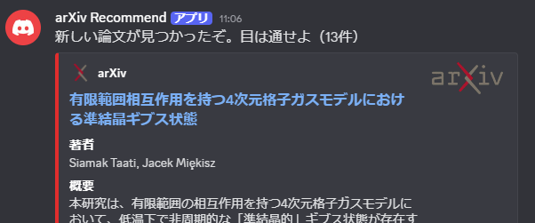

# ARXIV RECOMMENDER

毎日定時に事前に設定した興味ある分野に合致する新着プレプリントを [arXiv](https://arxiv.org) から取得して, 要約・日本語訳したものを [Discord](https://discord.com) に投稿し、詳細を対話形式で深掘りできる bot です.

LLM には OpenAI 互換 API ならどのプロバイダーでも使えます (OpenRouter, OpenAI, Google Gemini の OpenAI 互換 endpoint, 各種 Lab の互換 API など).

## 使用例



## 機能

1. **新着プレプリントの興味判定と要約投稿**
   - 毎日 1 回 (New York 時刻で 3 日前の日付) に指定カテゴリの新着論文を検索
   - 興味判定モデル (decision 系モデルを指定可能) が興味ありと判定した論文のみ要約
   - 要約を Discord の inbox チャンネルに投稿し、Bot が論文ごとに 📖 リアクションを付与
2. **📖 リアクションで全文リーディングメモ**
   - 📖 を付けると、論文全文 (PDF から自動抽出したテキスト) から日本語の「3分リーディングメモ」を生成して Forum に投稿
3. **Forum post での対話形式の論文读书 (Q&A)**
   - リーディングメモのスレッドに質問を書くと、その論文の本文に基づいて Bot が対話形式で回答
   - 論文内容の深掘りや、前提となっている概念の確認ができます
   - 既存スレッドに書き込めばアーカイブ済みスレッドでも再開します

## 使い方

GitHub Actions の cron で動作します. このリポジトリを fork してください (GitHub Actions を使用するため, Free プランの場合は fork 先を Public にしてください).

### 1. LLM プロバイダーの用意

OpenAI 互換 API を 1 つ用意し、以下を登録します.

| 種類 | 名前 | 説明 |
| --- | --- | --- |
| variable | `LLM_API_BASE` | 例: `https://openrouter.ai/api/v1` |
| secret | `LLM_API_KEY` | API キー |
| variable | `INTEREST_MODEL` | 興味判定用モデル (decision 系モデルを推奨) |
| variable | `SUMMARY_MODEL` | 要約生成用モデル (未設定なら `INTEREST_MODEL`) |
| variable | `READING_MODEL` | リーディングメモ用モデル (未設定なら `SUMMARY_MODEL`) |
| variable | `QA_MODEL` | Forum Q&A 用モデル (未設定なら `READING_MODEL`) |

役割ごとに別プロバイダーを使う場合は `<役割>_API_BASE` (variable) と `<役割>_API_KEY` (secret) を登録します (役割: `INTEREST`, `SUMMARY`, `READING`, `QA`).

既存の Gemini API キーを使い続ける場合は `LLM_API_BASE` を `https://generativelanguage.googleapis.com/v1beta/openai/` にし、`LLM_API_KEY` に Gemini API キーを登録してください.

### 2. Discord の用意

1. arXiv の情報を流す Discord の inbox チャンネルを作り、サーバー設定の連携アプリから webhook URL を取得してください
2. リーディングメモ用の Forum チャンネルも作ってください
3. Discord Developer Portal で Bot を作成します
   - **Bot 設定ページの Privileged Gateway Intents で `MESSAGE CONTENT INTENT` を有効にしてください** (Forum Q&A で投稿本文を読むのに必須です。未設定だと質問を読めず Q&A が黙って動かなくなります)
   - token を `DISCORD_BOT_TOKEN` (secret) として登録
   - 招待時の permission integer には `34359831616` を使えます (View Channel, Send Messages, Embed Links, Add Reactions, Read Message History, Create Public Threads が必要)
4. 以下を登録します

| 種類 | 名前 | 説明 |
| --- | --- | --- |
| secret | `ARXIV_RECOMMENDER_WEBHOOK_URL` | inbox チャンネルの webhook URL |
| variable | `DISCORD_FORUM_CHANNEL_ID` | Forum チャンネルの ID |
| variable | `DISCORD_USER_ID` (optional) | 特定ユーザーの 📖 / 質問のみを処理する場合の user ID |

### 3. 設定の調整

- `src/prompt_check_interest.txt`, `src/prompt_summarize.txt`, `src/prompt_reading_memo.txt`, `src/prompt_paper_qa.txt` を自分用に調整してください
- 検索カテゴリは repository variable `ARXIV_QUERY_CATEGORIES` で変更できます (既定: `cat:math.DS OR cat:math.CO OR cat:math.GR OR cat:cs.LO OR cat:cs.FL OR cat:cs.DM`)
  - 全カテゴリにすると処理件数が大幅に増えるので注意してください
- 1 日の処理件数は `ARXIV_MAX_RESULTS` (variable) で上限を付けられます

### 動作の仕組み

`.github/workflows/arxiv-bot.yml` が 5 分ごとに 1 回 `--stage poll` を実行します.

1. **検索** (毎日 1 回): 当日の検索窓 (NY 時刻で 3 日前, `ARXIV_LOOKBACK_DAYS` で変更可) に対応する job が state に無ければ arXiv 検索して新規 job を作成
2. **興味判定**: 未判定の論文に興味判定モデルを呼び出し
3. **要約・投稿**: 興味あり論文を要約して Discord に投稿、📖 リアクション付与
4. **📖 確認**: 📖 が付けられた論文の全文テキスト抽出とリーディングメモ生成、Forum post 作成
5. **Q&A**: Forum の active なスレッドに新着の人間の発言があれば、論文テキストと直近の対話を踏まえて回答

すべての段階で state を都度保存するため、何度実行しても同じ論文を二重に送信しません (べき等). 失敗した部分だけ次回の poll で再試行されます.

### state 管理ブランチについて

`pending_jobs.json` は `bot/manage-pending-jobs` ブランチ上で管理します.

- 形式: `{ "schema_version": 2, "jobs": [...] }`
- workflow は実行前に state を読み込み, 実行後に更新内容を同ブランチへ push します
- job の status は `processing` (処理中), `completed` (全送信完了), `completed_no_interests` (興味あり 0 件) の 3 つです
- 状態確認時は `status` に加えて `last_error`, `retry_count`, `updated_at` を見ると原因追跡しやすいです
- 質問への回答状況は各 message の `qa_last_read_message_id` (どこまで読んだか) と `qa_last_error` で確認できます

### 異常時の復旧手順

1. Actions の失敗した run のログを確認 (LLM 呼び出しや Discord API のエラー詳細が出ています)
2. `bot/manage-pending-jobs` の `state/pending_jobs.json` で該当 job の `status` と `last_error` を確認
3. 設定を直したうえで、Actions から `arXiv Bot Poll` を `workflow_dispatch` で手動実行すると未完了分から再開します
4. 長期間停滞した job を手動で終了する場合は `state/pending_jobs.json` から該当 job を削除してください

### Q&A のよくある質問

- **回答まで時間がかかる**: poll が 5 分ごとなので、質問してから回答まで 5〜15 分程度かかります. 即時応答したい場合は gateway 型 bot への移行が必要です
- **アーカイブ済みスレッドについて**: どこかで発言すると自動的に unarchive されて active 一覧に戻るため、次回 poll で応答します
- **古い論文について**: 投稿後 `READING_REQUEST_WINDOW_DAYS` (既定 30 日) を過ぎると 📖 の新規処理は行いません
- **回答の精度**: 論文テキストは PDF からの自動抽出のため数式が崩れていることがあります. 回答でもその点が明示されます

## ローカルでの実行

**python 3.15** と `requirements.txt` のライブラリが必要です.

```bash
python -m pip install -r requirements.txt
python -m unittest discover -s test   # 自己検証
python src/main.py --stage poll       # 必要な環境変数を設定して実行
```

主な環境変数は GitHub Actions と同じ名前です (`LLM_API_BASE`, `LLM_API_KEY`, `INTEREST_MODEL` が必須). それ以外の既定値は `src/main.py` 冒頭を参照してください.

興味がありそうなプレプリントがなかった場合、その旨の通知は来ません.
